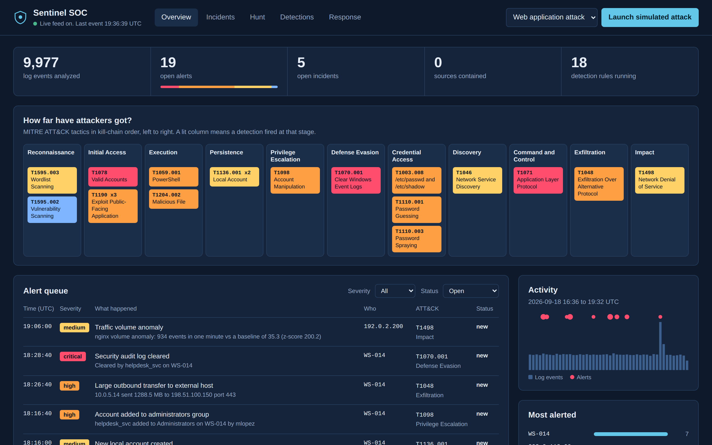
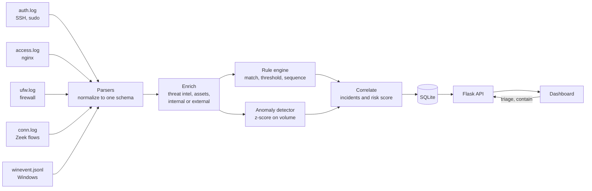

# Sentinel SOC

[](https://github.com/baabaalyb/sentinel-soc/actions/workflows/ci.yml)


A small Security Operations Center in a box. It reads logs from five different
kinds of systems, translates them into one common format, runs 18 detections
mapped to MITRE ATT&CK, folds related alerts into incidents with a risk score,
and gives an analyst a dashboard to triage, investigate, and respond.



## Why I built it

I wanted to build the part that is actually hard: the pipeline underneath. I found that most students' "SOC dashboards" are a chart on top of random numbers. Every alert
in this project traces back to specific raw log lines, a specific rule you can
read in plain YAML, and a specific ATT&CK technique. Nothing on the screen is
decorative.

It is a lab. The logs are synthetic (real attack logs cannot
be shared), response actions are simulated, and there is no login. The
[Limitations](#limitations-and-roadmap) section is honest about what would
have to change before this went near production.

## Run it in two minutes

Requires Python 3.9 or newer.

```bash
git clone https://github.com/baabaalyb/sentinel-soc.git
cd sentinel-soc
python3 -m venv .venv
source .venv/bin/activate          # Windows: .venv\Scripts\activate
pip install -r requirements.txt
python run.py demo
```

Open <http://127.0.0.1:5050>. The demo writes three hours of fresh logs
(about 10,000 lines) with five attacks hidden inside, analyzes them, and then
keeps a trickle of live traffic flowing. Pick a scenario in the top right and
press **Launch simulated attack** to watch the pipeline catch it in real time.

Other commands:

| Command | What it does |
|---|---|
| `python run.py evaluate` | Scores detections against the simulator's ground truth |
| `python run.py bench` | Measures events per second on your machine |
| `python run.py ingest FILES --reset` | Analyzes your own log files |
| `python run.py serve` | Opens the dashboard on the existing database |
| `pytest` | Runs the 83 tests |

Or with Docker: `docker build -t sentinel-soc . && docker run -p 127.0.0.1:5050:5050 sentinel-soc`

## How it works



1. **Parse.** Five parsers turn five formats into one `Event` shape
   (`src_ip`, `user`, `action`, `outcome`, and so on). Rules never see raw
   formats, so adding a sixth log source means writing one parser and
   touching nothing else. Malformed lines return `None` and never raise.
2. **Enrich.** Each event is tagged: is the source inside our network? Is the
   destination on the threat intelligence list? Which asset is this, and how
   critical is it?
3. **Detect.** Rules are YAML, in the spirit of [Sigma](https://github.com/SigmaHQ/sigma),
   and come in three types:
   - `match`: one event is enough (a SQL injection string in a URL)
   - `threshold`: N events, or N *distinct values*, per source per window
     (15 different ports in 60 seconds is a port scan; 60 hits on one port is not)
   - `sequence`: several of A, then B, from the same source
     (many failed logins, *then a success*)

   A statistical detector runs alongside and flags minutes whose volume is
   far above a rolling 30 minute baseline.
4. **Correlate.** Alerts about the same entity inside an hour become one
   incident. Internal IPs are resolved to asset names first, so `10.0.5.14`
   and `WS-014` land in the same incident. Host-only alerts (a sudo command
   carries no source IP) attach to the open incident already touching that host.
5. **Respond.** The analyst acknowledges, closes, or marks false positives,
   and can contain a source IP. Every action lands in an audit trail.

More detail: [docs/ARCHITECTURE.md](docs/ARCHITECTURE.md) and the full rule
catalog in [docs/DETECTIONS.md](docs/DETECTIONS.md).

## Detection coverage

18 detections across 11 ATT&CK tactics. Each rule file carries its logic, a
plain-English explanation, known false positives, and a response playbook.

| Tactic | Detections |
|---|---|
| Reconnaissance | Attack tool user agent (T1595.002), web directory enumeration (T1595.003) |
| Initial Access | SQL injection, XSS, path traversal (T1190), login success after failures (T1078) |
| Execution | Encoded PowerShell (T1059.001), Office app spawning a shell (T1204.002) |
| Persistence | New local account (T1136.001) |
| Privilege Escalation | Account added to administrators (T1098) |
| Defense Evasion | Security log cleared (T1070.001) |
| Credential Access | SSH brute force (T1110.001), password spraying (T1110.003), shadow file read (T1003.008) |
| Discovery | Port scan (T1046) |
| Command and Control | Outbound connection to threat-intel listed address (T1071) |
| Exfiltration | Large outbound transfer (T1048) |
| Impact | Traffic volume anomaly (T1498) |

## Measured results

`python run.py evaluate` plants 19 expected detections from five attack
scenarios inside roughly 10,000 ordinary log lines, plus five benign
look-alikes built to sit just under a threshold (a user who mistypes a
password three times, a 2 GB backup to an *internal* server, PowerShell
with `-ExecutionPolicy Bypass` but no encoding).

```
Expected detections : 19
Detected            : 19   (recall 1.0)
Unexpected alerts   : 0    (precision 1.0)
```

**Read that honestly:** the data is synthetic and generated by this same
project, so this proves the pipeline behaves as designed, the way a test
suite does. It is not a claim about catching real attackers, who do not
follow my simulator's script. CI runs this evaluation on every push and
fails the build if a detection regresses.

Throughput is about 20,000 events per second in a single process, including
SQLite writes, on the machine it was last benchmarked on. Run
`python run.py bench` for your own number.

## Design decisions worth asking me about

- **Rules as data, not code.** Detections change weekly; engines should not.
  A teammate can add a rule without reading Python.
- **Distinct counting.** Password spraying is invisible to a plain counter
  because each account sees one failure. Counting *distinct usernames per
  source* is what exposes it.
- **Suppression.** A 5,000 attempt brute force should be one alert, not 5,000.
  Each rule has a per-entity suppression window. Alert fatigue is a bigger
  real-world problem than missed detections.
- **Decode before you match.** URLs are percent-decoded repeatedly (capped at
  three passes) so `%2527` cannot sneak a quote past the SQL injection rule.
  Encoded PowerShell is Base64-decoded so the alert shows what actually ran.
- **The anomaly baseline refuses to learn from anomalies.** Flagged minutes
  are not added to the baseline, so an attacker cannot slowly teach the
  detector that floods are normal.
- **A saturating risk score.** `100 * (1 - e^(-points/70))`. The first few
  findings move the score most, and it can never exceed 100.
- **Containment has a guardrail.** The response module refuses to block
  internal addresses or inventoried assets. Automation that can take down
  your own domain controller is an outage waiting to happen.

## The tool's own security

A security tool that is itself vulnerable is embarrassing, and this one
displays attacker-controlled strings all day.

- The dashboard never uses `innerHTML`. Every node is built with
  `textContent`, a test enforces it, and a strict Content-Security-Policy
  (`script-src 'self'`, no inline) is the second layer. A logged
  `<script>` tag is inert.
- Every SQL statement is parameterized. `LIKE` wildcards from search input
  are escaped.
- Alert summaries use plain placeholder substitution, not `str.format()`,
  so log content cannot reach object attributes.
- Rule files load with `yaml.safe_load`.
- State-changing requests must be JSON and same-origin. The server binds to
  `127.0.0.1` and never runs in debug mode.
- Attacker addresses in sample data use the RFC 5737 documentation ranges, so
  no real network is ever labelled malicious.

## Write your own rule

Drop a file in `rules/`. It loads on the next start, and a bad rule fails
loudly at startup instead of silently at 3am.

```yaml
id: SEN-101
title: Login outside business hours
severity: medium
type: match
match:
  action: ssh_login
  outcome: success
  user|in: [deploy, backup]
mitre: {tactic: Initial Access, technique: T1078, name: Valid Accounts}
explain: A key card used at 3am by someone who works nine to five.
response: [Confirm with the account owner]
```

Operators: `eq` (default), `ne`, `in`, `re`, `contains`, `contains_any`,
`gte`, `lte`, `exists`. Write them as `field|operator: value`.

## Project layout

```
sentinel/
  parsers/        one file per log format
  engine.py       rule loading and the three rule types
  anomaly.py      z-score volume detector
  enrich.py       threat intel, asset inventory, internal/external
  correlate.py    incidents and risk scoring
  respond.py      simulated containment with guardrails
  pipeline.py     ties the stages together
  simulator.py    log generator with ground truth
  evaluate.py     recall and precision against ground truth
  storage.py      SQLite
  web/            Flask API and the dashboard
rules/            17 YAML detections
data/             threat intel list and asset inventory
samples/          a generated set of logs you can read
tests/            83 tests
```

## Limitations and roadmap

- **Synthetic data only.** Next step: replay public datasets such as the
  SecRepo auth logs or Splunk BOTS and measure against those.
- **No authentication.** Fine on localhost, unacceptable anywhere else.
  Next: login, roles (analyst vs. read-only), and per-user audit entries.
- **Single process, SQLite.** Production SIEMs shard across clusters. The
  pipeline stages are separated so a queue (Kafka, Redis) could sit between them.
- **Batch and simulated-live input.** Next: tail real files or accept syslog
  over the network.
- **Static threat intel.** Next: pull a live feed (AbuseIPDB, abuse.ch) with
  caching and expiry, since stale intel is a false positive source.
- **Rule format is Sigma-inspired, not Sigma-compatible.** A converter would
  unlock thousands of community rules.

## License

MIT. See [LICENSE](LICENSE).
